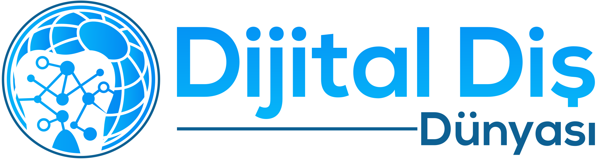
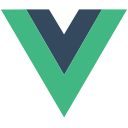
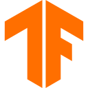
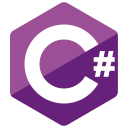
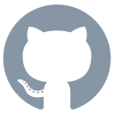

  
  
  
  

<a href="mailto:ramazanyldr0103@gmail.com">Email</a> · <a href="#cv-and-portfolio">CV &amp; portfolio documents</a>

## About me

Computer Engineering student, graduating in 2027. I focus on **deep learning, computer vision, and Turkish NLP**, and build backend and web applications with FastAPI, Laravel, PHP, and Vue.js.

I am interested in practical, reproducible software and AI systems.

## Selected work

  

  <strong>Co-Founder &amp; Developer</strong>

  <strong>An integrated digital platform for the dental ecosystem.</strong> 
  Connecting clinics, laboratories, suppliers, patients, and professionals across procurement, operations, communication, and AI-assisted workflows.

  

### [Turkish sentiment analysis](https://github.com/Ramazan-yildirim/berturk_turkish_sentiment_analysis)

BERTurk fine-tuning for positive, negative, and neutral Turkish text classification, with a Streamlit interface and a separate similarity-search workflow.

Python · BERTurk · Transformers · Streamlit

### [Turkish named entity recognition](https://github.com/Ramazan-yildirim/turkish-ner-berturk)

Recognizing people, organizations, and locations in Turkish text with BERTurk and WikiANN, including error analysis and experiments with entity-aware vector search.

Python · BERTurk · WikiANN · ChromaDB

## Tech stack

**AI & Computer Vision**

&nbsp; &nbsp; &nbsp; &nbsp; 

Python · PyTorch · Hugging Face · OpenCV · MediaPipe

**Backend & Web**

&nbsp; &nbsp; &nbsp; &nbsp; 

FastAPI · Laravel · PHP · Vue.js · JavaScript

**Tools**

&nbsp; &nbsp; 

Docker · Linux · Git

Other technologies

&nbsp; &nbsp; &nbsp; &nbsp; &nbsp; &nbsp; 

TensorFlow · C# · .NET · HTML5 · CSS3 · PowerShell · GitHub

## GitHub activity

  <a href="https://github.com/Ramazan-yildirim">
  <picture>
    <source media="(max-width: 600px) and (prefers-color-scheme: dark)" srcset="https://ramazan-github-stats.vercel.app/api/stats?theme=dark&amp;layout=compact">
    <source media="(max-width: 600px)" srcset="https://ramazan-github-stats.vercel.app/api/stats?theme=light&amp;layout=compact">
    <source media="(prefers-color-scheme: dark)" srcset="https://ramazan-github-stats.vercel.app/api/stats?theme=dark">
    <source media="(prefers-color-scheme: light)" srcset="https://ramazan-github-stats.vercel.app/api/stats?theme=light">
    
  </picture>
  </a>

  <picture>
    <source media="(max-width: 600px) and (prefers-color-scheme: dark)" srcset="https://ramazan-github-stats.vercel.app/api/languages?theme=dark&amp;layout=compact">
    <source media="(max-width: 600px)" srcset="https://ramazan-github-stats.vercel.app/api/languages?theme=light&amp;layout=compact">
    <source media="(prefers-color-scheme: dark)" srcset="https://ramazan-github-stats.vercel.app/api/languages?theme=dark">
    <source media="(prefers-color-scheme: light)" srcset="https://ramazan-github-stats.vercel.app/api/languages?theme=light">
    
  </picture>

## Documents

<strong>CV &amp; Portfolio</strong>

 

### CV

<table>
  <tr>
    <td align="center" width="50%">
      <strong>English CV</strong>  
      
    </td>
    <td align="center" width="50%">
      <strong>Türkçe CV</strong>  
      
    </td>
  </tr>
</table>

  
  

### Portfolio

<table>
  <tr>
    <td align="center" width="50%"></td>
    <td align="center" width="50%"></td>
  </tr>
</table>

  
  

## Contribution Snake

  <picture>
    <source media="(prefers-color-scheme: dark)" srcset="https://raw.githubusercontent.com/Ramazan-yildirim/Ramazan-yildirim/output/github-contribution-grid-snake-dark.svg">
    <source media="(prefers-color-scheme: light)" srcset="https://raw.githubusercontent.com/Ramazan-yildirim/Ramazan-yildirim/output/github-contribution-grid-snake.svg">
    
  </picture>

