

  <a href="https://ramazanyildirim.vercel.app/">
    <picture>
      <source media="(max-width: 600px) and (prefers-color-scheme: dark)" srcset="assets/brand/header-dark-compact.svg">
      <source media="(max-width: 600px)" srcset="assets/brand/header-light-compact.svg">
      <source media="(prefers-color-scheme: light)" srcset="assets/brand/header-light.svg">
      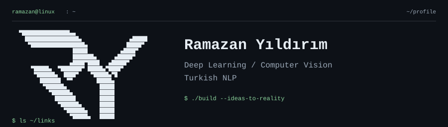
    </picture>
  </a>

  <a href="https://ramazanyildirim.vercel.app/"><picture><source media="(prefers-color-scheme: light)" srcset="assets/ui/website-light.svg"></picture></a>
  <a href="https://raw.githubusercontent.com/Ramazan-yildirim/CV_Portfolio/main/CV/output/Ramazan_Yildirim_CV_EN.pdf"><picture><source media="(prefers-color-scheme: light)" srcset="assets/ui/cv-light.svg"></picture></a>
  <a href="https://raw.githubusercontent.com/Ramazan-yildirim/CV_Portfolio/main/portfolio/output/Ramazan_Yildirim_Portfolyo.pdf"><picture><source media="(prefers-color-scheme: light)" srcset="assets/ui/portfolio-light.svg"></picture></a>
  <a href="https://www.linkedin.com/in/ramazanyldr/"><picture><source media="(prefers-color-scheme: light)" srcset="assets/ui/linkedin-light.svg">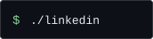</picture></a>
  <a href="mailto:ramazanyldr0103@gmail.com"><picture><source media="(prefers-color-scheme: light)" srcset="assets/ui/email-light.svg"></picture></a>

<table align="center">
<tr><td align="left" valign="middle" width="240" height="40" nowrap>

<samp>CV&nbsp;&nbsp;&nbsp;&nbsp;&nbsp;&nbsp;&nbsp;&nbsp;&nbsp;│&nbsp;preview</samp>

 

<h3><code>./cv --list</code></h3>

<table>
  <tr>
    <td align="center" width="50%">
      <strong>English CV</strong>  
      
    </td>
    <td align="center" width="50%">
      <strong>Türkçe CV</strong>  
      
    </td>
  </tr>
</table>

  <a href="https://raw.githubusercontent.com/Ramazan-yildirim/CV_Portfolio/main/CV/output/Ramazan_Yildirim_CV_EN.pdf"><picture><source media="(prefers-color-scheme: light)" srcset="assets/ui/download-cv-en-light.svg">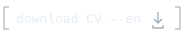</picture></a>
  <a href="https://raw.githubusercontent.com/Ramazan-yildirim/CV_Portfolio/main/CV/output/Ramazan_Yildirim_CV_TR.pdf"><picture><source media="(prefers-color-scheme: light)" srcset="assets/ui/download-cv-tr-light.svg">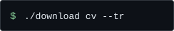</picture></a>

</td></tr>
</table>

<table align="center">
<tr><td align="left" valign="middle" width="240" height="40" nowrap>

<samp>Portfolio&nbsp;&nbsp;│&nbsp;preview</samp>

 

<h3><code>./portfolio --preview</code></h3>

<table>
  <tr>
    <td align="center" width="50%"></td>
    <td align="center" width="50%"></td>
  </tr>
</table>

  <a href="https://raw.githubusercontent.com/Ramazan-yildirim/CV_Portfolio/main/portfolio/output/Ramazan_Yildirim_Portfolyo.pdf"><picture><source media="(prefers-color-scheme: light)" srcset="assets/ui/download-portfolio-light.svg">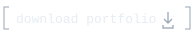</picture></a>
  <a href="https://github.com/Ramazan-yildirim/CV_Portfolio"><picture><source media="(prefers-color-scheme: light)" srcset="assets/ui/cv-repository-light.svg"></picture></a>

</td></tr>
</table>

## `$ whoami`

  <picture>
    <source media="(max-width: 600px)" srcset="assets/terminal/about-compact.svg">
    
  </picture>

## `$ ls ~/projects/dijital-dis-dunyasi`

  <a href="https://dijitaldisdunyasi.com">
    <picture>
      <source media="(max-width: 600px)" srcset="assets/terminal/project-compact.svg">
      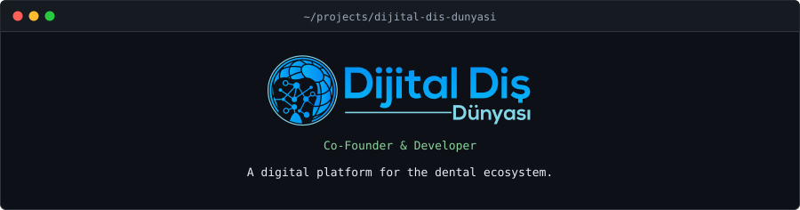
    </picture>
  </a>

  <a href="https://dijitaldisdunyasi.com"><picture><source media="(prefers-color-scheme: light)" srcset="assets/ui/visit-platform-light.svg">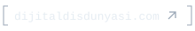</picture></a>

## `$ ls ~/stack`

<code>~/stack/ai-and-computer-vision</code>

  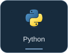
  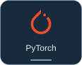
  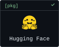
  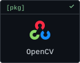
  

<code>~/stack/backend-and-web</code>

  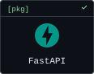
  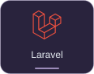
  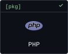
  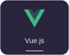
  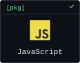

<code>~/stack/tools</code>

  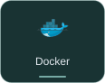
  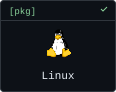
  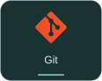

<code>ls ~/stack/other</code> — Other technologies

  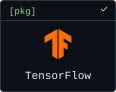
  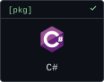
  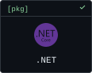
  
  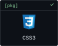
  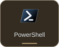
  

## `$ gh stats --user Ramazan-yildirim`

  <a href="https://github.com/Ramazan-yildirim">
  <picture>
    <source media="(max-width: 600px) and (prefers-color-scheme: dark)" srcset="https://ramazan-github-stats.vercel.app/api/stats?v=terminal-v2&amp;theme=dark&amp;layout=compact">
    <source media="(max-width: 600px)" srcset="https://ramazan-github-stats.vercel.app/api/stats?v=terminal-v2&amp;theme=light&amp;layout=compact">
    <source media="(prefers-color-scheme: dark)" srcset="https://ramazan-github-stats.vercel.app/api/stats?v=terminal-v2&amp;theme=dark">
    <source media="(prefers-color-scheme: light)" srcset="https://ramazan-github-stats.vercel.app/api/stats?v=terminal-v2&amp;theme=light">
    
  </picture>
  </a>

  <picture>
    <source media="(max-width: 600px) and (prefers-color-scheme: dark)" srcset="https://ramazan-github-stats.vercel.app/api/languages?v=terminal-v2&amp;theme=dark&amp;layout=compact">
    <source media="(max-width: 600px)" srcset="https://ramazan-github-stats.vercel.app/api/languages?v=terminal-v2&amp;theme=light&amp;layout=compact">
    <source media="(prefers-color-scheme: dark)" srcset="https://ramazan-github-stats.vercel.app/api/languages?v=terminal-v2&amp;theme=dark">
    <source media="(prefers-color-scheme: light)" srcset="https://ramazan-github-stats.vercel.app/api/languages?v=terminal-v2&amp;theme=light">
    
  </picture>

## `$ ./contribution-snake`

  <picture>
    <source media="(prefers-color-scheme: dark)" srcset="https://raw.githubusercontent.com/Ramazan-yildirim/Ramazan-yildirim/output/github-contribution-grid-snake-dark.svg">
    <source media="(prefers-color-scheme: light)" srcset="https://raw.githubusercontent.com/Ramazan-yildirim/Ramazan-yildirim/output/github-contribution-grid-snake.svg">
    
  </picture>

<code>ramazan@linux:~ $ exit</code> Thanks for visiting. See you in the next session.

